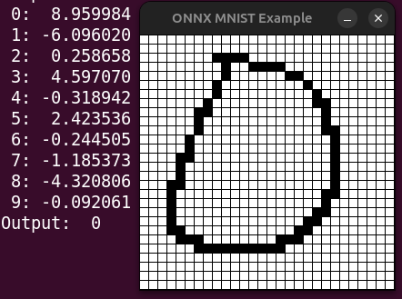

# Examples for ONNX Runtime

1. MNIST - the handwriting recognition

   1. Download the model from https://github.com/microsoft/onnxruntime-inference-examples/tree/main/c_cxx/MNIST

          curl -LO https://github.com/microsoft/onnxruntime-inference-examples/raw/main/c_cxx/MNIST/mnist.onnx

   2. Build examples with `alr build`
   3. Run `./bin/mnist`. It will recognize an embedded image:

          Result: 7

   To simplify the source code we don't provide image loading, but
   recognize an image buffer embedded into the source instead.

2. ljspeech - TTS (text-to-speech)

   1. Download the model from
      https://huggingface.co/NeuML/ljspeech-jets-onnx
   2. Run `./bin/ljspeech`. It will generate a speech into
      `test.wav`. The text is embedded into the source code
      as a token sequence. It was created by
      https://github.com/neuml/ttstokenizer.

3. SDL/MNIST - an interactive MNIST example using SDL for user input.
   The operator can draw on the model input surface using the mouse:

   - **Left click**: Draw model input point
   - **Right click**: Clear model input

   

   1. Download the model from https://github.com/microsoft/onnxruntime-inference-examples/tree/main/c_cxx/MNIST

          curl -LO https://github.com/microsoft/onnxruntime-inference-examples/raw/main/c_cxx/MNIST/mnist.onnx

   2. Build examples with `alr -C examples/SDL build`
   3. Run `./examples/SDL/bin/mnist_sdl`. Use the mouse to draw a digit.

4. StyleTTS2 Ukraininan TTS

   1. Fetch `model.onnx` and `style.pt` from
      [huggingface](https://huggingface.co/patriotyk/styletts2_ukrainian_single)
   2. Fix `model.onnx` with Python script:
      ```python
      """Replace negative axes in Transpose 'perm' attributes with their positive value.

      A negative axis -k in a permutation of length n means n-k, so -1 becomes n-1.
      ONNX Runtime rejects negative values in 'perm' for some exported graphs.
      Usage: python fix_transpose.py IN.onnx OUT.onnx
      """
      import sys
      import onnx

      src, dst = sys.argv[1], sys.argv[2]
      model = onnx.load(src)
      fixed = []
      for node in model.graph.node:
          if node.op_type != "Transpose":
              continue
          for attr in node.attribute:
              if attr.name == "perm" and any(v < 0 for v in attr.ints):
                  rank = len(attr.ints)
                  before = list(attr.ints)
                  attr.ints[:] = [v + rank if v < 0 else v for v in before]
                  fixed.append((node.name, before, list(attr.ints)))
      onnx.save(model, dst)
      for name, before, after in fixed:
          print(f"fixed {name}: {before} -> {after}")
      print(f"{len(fixed)} node(s) fixed; wrote {dst}")
      ```
   3. Extract `STYLE.bin` from `style.pt`
      ```shell
      unzip -j style.pt filatov/data/0 && mv 0 STYLE.bin
      ```
   4. Run `bin/styletts2 MODEL.onnx STYLE.bin OUTPUT.wav`
